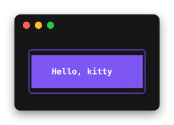
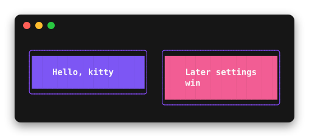
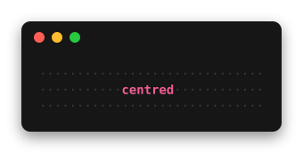
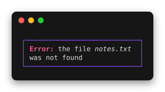
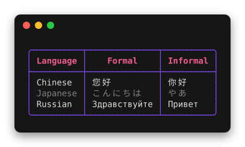
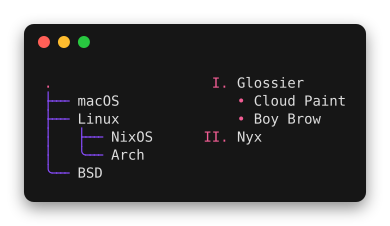
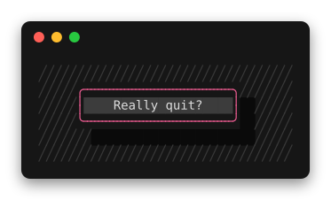
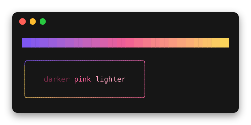

# lipstick

Style definitions for nice terminal layouts, in Haskell. lipstick is a port
of [lipgloss](https://github.com/charmbracelet/lipgloss) (v2) for
command-line programs: colours, borders, padding, alignment, tables, lists,
trees and layered compositions, rendered to text with ANSI escape sequences.

```haskell
{-# LANGUAGE OverloadedStrings #-}
import Lipstick

card :: Mod Style
card =
  bold
    <> fg "#FAFAFA"
    <> bg "#7D56F4"
    <> padding 1 4
    <> width 24
    <> border roundedBorder
    <> borderFg "#874BFD"

main :: IO ()
main = putBlock (render card "Hello, kitty")
```



lipstick is on Hackage and builds with GHC 9.10, 9.12 and 9.14. Add it to
the `build-depends` of your package:

```
build-depends: lipstick ^>=0.1
```

For brick and vty applications, add
[`lipstick-brick`](https://hackage.haskell.org/package/lipstick-brick) too.

The examples import `Lipstick` whole and use `OverloadedStrings`; the table
example also uses `LambdaCase` (part of GHC2024), the layers example
`import Data.Text qualified as T`, and the output example
`import System.IO (stdout)`. Some of lipstick's names (`bold`, `fg`,
`border`, `center`, `text`, `render`, `width`, the colour names) are also
exported by brick, vty, colour or prettyprinter; programs that use those
too can `import Lipstick qualified as L`.

## Styles are modifiers

A `Mod Style` is a modifier, in the same sense as optparse-applicative's
`Mod`: modifiers form a monoid and later settings win, so styles are built
and extended with `<>`.

```haskell
warning :: Mod Style
warning = card <> bg "#F25D94"
```

Text attributes (`fg`, `bg`, `bold`, `underline`, `link`, …) apply to
every kind of thing lipstick draws, not just styles, so the same modifier
works everywhere:

```haskell
base :: Mod f
base = fg red <> bold

render base "text"            -- a styled box
table base headers rows       -- the base style of a table
list base items               -- the base style of a list
```

Other modifiers apply to the things that have the corresponding part:
`padding` and `margin` to styles, `border` to styles and tables, `width` to
styles, tables, lists, trees and placed blocks, `align` to styles and placed
blocks, and the `maxWidth` / `maxHeight` crop to everything but `styled`
text. A modifier on something that does not support it is a type error.

The sizes mean the same for everything that has them. With `width n`, a
thing is `n` columns wide when there is room, and with less it shrinks like
any other. `height n` is the least number of lines. For a style, `width`
and `height` include padding and border but not margins, as in lipgloss.
`maxWidth` and `maxHeight` crop the whole result, a style's margins
included, to at most that many columns or lines; with `maxHeight`, a table
leaves out body rows instead. With a width, text is word-wrapped to fit, or
cut with an ellipsis with `noWrap`.

## Blocks and layout

`render` returns a `Block`: a rectangle of styled text, which gets its width
only when it is laid out.

```haskell
joinHorizontal center
  [ render card "Hello, kitty"
  , render (warning <> marginLeft 2) "Later settings win"
  ]
```



```haskell
place
  (width 30 <> height 3 <> align center <> valign center <> whitespaceChars "·" <> fg "#383838")
  (render (bold <> fg "#F25D94") "centred")
```



`frame` puts an existing block in a box: `render style text` is
`frame style (fromInline text)`. A style's text settings (`align`,
`noWrap`, `breakAfter`, `tabWidth`, `transform`, `inline`) apply, like its
colours, to all the text inside what it frames, unless something nearer
sets them again. `hcat` / `joinHorizontal` put blocks side by side and
`vcat` / `joinVertical` stack them.

Text in a block wraps to the width the block is laid out in. `fillWidth`
(or `grow n`, for a weighted share) makes a block take the spare columns of
its row, and `stretchHeight` makes it as tall as the tallest block next to
it. The output functions lay blocks out in the `RenderEnv`'s width (with
`Nothing`, at their natural width); `layout` does it explicitly.

## Text

Text with several styles is `Inline`, built with `styled` and `<>`. Styles
nest: the attributes of the enclosing style show through wherever the inner
ones do not set them.

```haskell
render
  (width 30 <> border normalBorder <> borderFg "#874BFD" <> padding 0 1)
  (styled (bold <> fg "#F25D94") "Error: " <> "the file " <> styled italic "notes.txt" <> " was not found")
```



Output from other programs that already contains escape sequences goes
through `fromAnsi`, which keeps colours, attributes and hyperlinks and drops
everything else:

```haskell
render (border roundedBorder) (fromAnsi "\ESC[1;32mok\ESC[0m 3 tests passed")
```

Also: `breakAfter` (wrap after extra characters such as `-`),
`styleRanges` and `styleIndices` (highlight columns or characters of
existing text, e.g. fuzzy-search matches), `transform`, `ansiWidth`.

Widths follow the Unicode 16.0.0 grapheme cluster rules (the official
conformance tests pass) and East Asian Width, so CJK text, emoji, flags and
combining marks line up.

## Tables

```haskell
table
  ( borderFg "#874BFD"
      <> headerStyle (bold <> fg "#F25D94" <> align center)
      <> cellStyle (\case BodyCell r _ | odd r -> padding 0 1 <> faint; _ -> padding 0 1)
  )
  ["Language", "Formal", "Informal"]
  [ ["Chinese", "您好", "你好"]
  , ["Japanese", "こんにちは", "やあ"]
  , ["Russian", "Здравствуйте", "Привет"]
  ]
```



Cells are blocks, so they can hold lists, other tables or anything else.
A table fits the width it is laid out in: columns shrink, wrapping their
cells, widest first but without breaking a word while another column can
still wrap (headers are cut short instead), and with `fillWidth` they grow
to fill it. With a `width`, columns shrink or grow to fit that instead;
`fitContent` makes the width a maximum. With a `maxHeight`, the body rows
that do not fit are left out, with a row of `…` in their place where it
fits, `yOffset` scrolls, and `visibleRows` tells which rows are shown; a
`height` adds empty rows up to it. `headerRule`, `columnRules`, `rowRules`
and the `border*` modifiers choose which lines are drawn.

## Lists and trees

Trees take a `Data.Tree`; items are blocks, so anything can go in them,
tables included.

```haskell
tree
  (enumerator roundedTreeEnumerator <> enumeratorStyle (fg "#874BFD") <> rootStyle (fg "#F25D94"))
  (Node "." [Node "macOS" [], Node "Linux" [Node "NixOS" [], Node "Arch" []], Node "BSD" []])

nestedList
  (enumerator (byDepth (\depth -> if depth == 0 then roman else bullet)) <> enumeratorStyle (fg "#F25D94"))
  [Node "Glossier" [Node "Cloud Paint" [], Node "Boy Brow" []], Node "Nyx" []]
```



The enumerators are `treeEnumerator`, `roundedTreeEnumerator`, `bullet`,
`dash`, `asterisk`, `arabic`, `alphabet` and `roman`, or your own, made
with `markers`. Items, enumerators and indentation are styled separately,
by position if needed. Items wrap in the width left after their
indentation.

## Layers

Blocks can be stacked at any position, for dialogs, overlays and the like.
`layerAt` finds the named layer under a point, for mouse handling.

```haskell
compose
  [ layer (fg "#383838") (text (T.intercalate "\n" (replicate 6 (T.replicate 34 "╱"))))
  , layer (offset 7 2 <> zIndex 1) (render (bg "#0A0A0A" <> width 22 <> height 3) "")
  , layer
      (offset 5 1 <> zIndex 2 <> layerId "dialog")
      (render (border roundedBorder <> borderFg "#F25D94" <> bg "#3C3C3C" <> padding 0 2 <> width 22 <> align center) "Really quit?")
  ]
```



## Colours

Colours are written as `"#7D56F4"`, `"#fa0"`, palette indices (`"201"`,
`"5"`) or names (`red`, `brightBlue`, …). Adaptive colours are resolved only
when printing:

- `lightDark light dark` picks by the terminal background;
- `complete trueColor color256 color16` picks by what the terminal supports.

`blend` and `blend2D` make gradients, `darken`, `lighten` and `complementary`
adjust colours; they work in the OkLab colour space. `borderFgBlend` draws a
gradient around a border.

```haskell
vcat
  [ hcat [render (bg c) "  " | c <- blend 24 ["#7D56F4", "#F25D94", "#FAD45A"]]
  , text ""
  , render
      (border roundedBorder <> borderFgBlend ["#7D56F4", "#F25D94", "#FAD45A"] <> padding 1 4)
      ( styled (fg (darken 0.4 "#F25D94")) "darker "
          <> styled (fg "#F25D94") "pink "
          <> styled (fg (lighten 0.4 "#F25D94")) "lighter"
      )
  ]
```



## Output

`putBlock` and `hPutBlock` print a block, reducing colours to what the
output supports. Detection follows the usual conventions: no escape
sequences when the output is not a terminal (unless `CLICOLOR_FORCE` is
set to anything but `0`), no colours with `NO_COLOR`, and the colour depth
from `COLORTERM` and `TERM`. On Windows the console's ANSI processing is
switched on as needed. Blocks are laid out in `COLUMNS` if it is set to a
positive number, even when the output is not a terminal, or else in the
terminal's width; output that is not going to a terminal otherwise keeps
its natural width.

The background is taken from `COLORFGBG` when the terminal sets it and is
assumed dark otherwise. To ask the terminal, which takes a round trip and
reads from stdin, detect once and keep the result:

```haskell
main = do
  env <- detectEnvQuery stdout
  hPutBlockWith env stdout (render card "Hello")
```

`toAnsi env block` gives the text without printing it, and `renderPlain`
gives it without any escape sequences.

## brick and vty

[`lipstick-brick`](https://hackage.haskell.org/package/lipstick-brick)
shows blocks in brick and vty applications. It uses only the public API:
`Lipstick.Grid` gives the laid-out lines, cells and styled spans of a
block, so blocks can be shown in other outputs too.

## How lipstick differs from lipgloss

lipgloss renders to strings with escape sequences in them, and measures and
joins them by parsing those sequences again. lipstick renders to blocks of
styled spans and produces escape sequences only when printing. Layout never
parses an escape sequence, and adaptive colours are resolved for the actual
terminal when printing.

lipgloss is where lipstick started, not a compatibility target: where a
clearer rule exists, lipstick follows it. Notable differences:

- Nested styles keep the outer style. In lipgloss the outer style wraps the
  line once, so a reset at the end of nested styled text ends it for the
  rest of the line.
- The text attributes of any thing are the base for everything it draws:
  for a table they are lipgloss's `BaseStyle`, and for `place` they apply to
  the placed block as well as to the whitespace.
- Lists and trees are both `Outline`s (`Mod Tree` would clash with
  `Data.Tree`).
- Blocks are laid out in the width they are given, so text and tables
  reflow without explicit widths.
- Table columns shrink as CSS tables do: not below their longest word while
  another column can still wrap. lipgloss shrinks columns by their median
  cell width and may break words that did not need breaking.
- An emoji with a skin tone modifier is two columns wide even when the
  emoji alone is one, as in `☝🏻` (UTS #51). lipgloss measures it by its
  first character, one column.

Not ported: `Alpha` (terminals cannot show transparency), the Windows
build-number check (lipstick asks the console to switch on ANSI processing,
and prints plain text where it cannot), and Go-specific API such as
`SetString`, `Copy`, `WrapWriter` and the table data interfaces, which
plain values and lists cover.

## Compared with layoutz

I did not know about [layoutz](https://hackage.haskell.org/package/layoutz)
while writing lipstick, and came across it only when preparing the first
release. It is another Haskell library for terminal output, and it does a
lot that lipstick does not: charts (bars, sparklines, braille line and pie
plots, heatmaps), spinners and progress bars, inline images for kitty,
interactive prompts and a small Elm-style application runtime, all in one
module with only boot-package dependencies. For a quick dashboard or an
animated script, it is worth a look.

The two are built differently. layoutz renders each element to a `String`
with escape sequences in it and measures it again by stripping them;
lipstick renders to blocks of styled cells and produces escape sequences
only when printing. From the source of layoutz 0.4.0.0:

|                        | layoutz                                                          | lipstick                                                    |
| ---------------------- | ---------------------------------------------------------------- | ----------------------------------------------------------- |
| Width of text          | a list of wide ranges: CJK lines up, emoji sequences and flags do not | Unicode grapheme clusters and East Asian Width          |
| Colours                | foreground only, in 16, 256 or 24-bit colour                     | foreground, background and underline; light/dark and per-profile colours; gradients |
| Terminal support       | always prints escape sequences                                   | `NO_COLOR`, `CLICOLOR_FORCE`, `COLORTERM`, `TERM`; colours reduced to what the output shows |
| Nested styles          | an inner style ends the outer one                                | the outer style shows through                               |
| Layout                 | as wide as the content; wrapping at a given width                | laid out in the width available: text wraps, tables shrink their columns |
| Tables                 | columns as wide as their widest cell                             | columns that shrink and grow, styles by cell, scrolling     |
| Placing and layers     | no                                                               | `place`, `compose`, hit testing                             |
| Existing ANSI text, hyperlinks | no                                                       | `fromAnsi`, `link`                                          |
| Charts, spinners, prompts, application loop | yes                                         | no; for full-screen applications, brick through lipstick-brick |

## Documentation

The API documentation of the latest release is at
<https://andreabedini.github.io/lipstick/>.

Each [release](https://github.com/andreabedini/lipstick/releases) also has the
documentation of every package with a library, as
`PACKAGE-VERSION-docs.tar.gz`, in the format Hackage takes.

## Development

See
[CONTRIBUTING.md](https://github.com/andreabedini/lipstick/blob/main/CONTRIBUTING.md)
for building, testing, commit messages and releases.

## Licence

MIT, see [LICENSE](https://github.com/andreabedini/lipstick/blob/main/LICENSE). lipstick is a port of
[lipgloss](https://github.com/charmbracelet/lipgloss), © Charmbracelet,
also MIT licensed. The Unicode tables in
`internal/Lipstick/Internal/UnicodeTable.hs` are generated from the Unicode
Character Database, and `test/data/GraphemeBreakTest.txt` comes from it;
both are © Unicode, Inc., under the Unicode License v3, see
[LICENSE.Unicode](https://github.com/andreabedini/lipstick/blob/main/LICENSE.Unicode).
