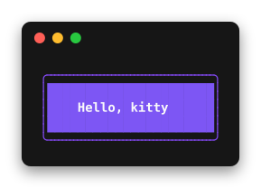
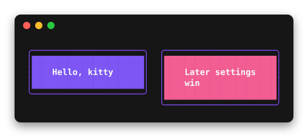
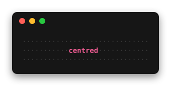
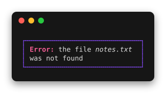
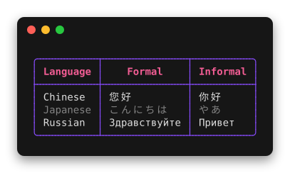
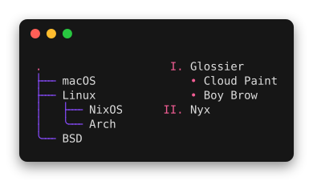
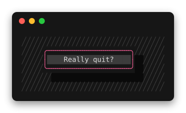
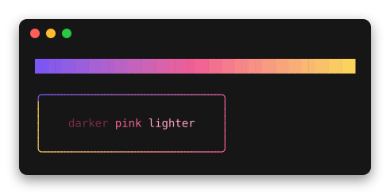

# lipstick

Style definitions for nice terminal layouts, in Haskell. lipstick is a port
of [lipgloss](https://github.com/charmbracelet/lipgloss) (v2) for
command-line programs: colours, borders, padding, alignment, tables, lists,
trees and layered compositions, rendered to text with ANSI escape sequences.

```haskell
{-# LANGUAGE OverloadedStrings #-}
import Lipstick

card :: Mod Style
card =
  bold
    <> fg "#FAFAFA"
    <> bg "#7D56F4"
    <> padding 1 4
    <> width 24
    <> border roundedBorder
    <> borderFg "#874BFD"

main :: IO ()
main = putBlock (render card "Hello, kitty")
```



lipstick builds with GHC 9.12 and is not on Hackage yet. To use it, add
the repository to your `cabal.project`:

```
source-repository-package
  type: git
  location: https://github.com/andreabedini/lipstick.git
  tag: <commit>
  subdir: . lipstick-brick
```

(`lipstick-brick` is only needed for brick and vty applications.)

## Styles are modifiers

A `Mod Style` is a modifier, in the same sense as optparse-applicative's
`Mod`: modifiers form a monoid and later settings win, so styles are built
and extended with `<>`.

```haskell
warning :: Mod Style
warning = card <> bg "#F25D94"
```

Text attributes (`fg`, `bg`, `bold`, `underline`, `link`, …) and the
`maxWidth` / `maxHeight` crop apply to every kind of thing lipstick draws,
not just styles, so the same modifier works everywhere:

```haskell
base :: Mod f
base = fg red <> bold

render base "text"            -- a styled box
table base headers rows       -- the base style of a table
list base items               -- the base style of a list
```

Other modifiers apply to the things that have the corresponding part:
`padding` and `margin` to styles, `border` to styles and tables, `width` to
styles, tables, lists, trees and placed blocks, `align` to styles and placed
blocks. A modifier on something that does not support it is a type error.

`width` and `height` include padding and border but not margins, as in
lipgloss. With a width, text is word-wrapped to fit, or cut with an ellipsis
with `noWrap`.

## Blocks and layout

`render` returns a `Block`: a rectangle of styled text that knows its width
and height. Blocks are joined, placed and framed without ever looking at
escape sequences.

```haskell
joinHorizontal center
  [ render card "Hello, kitty"
  , render (warning <> marginLeft 2) "Later settings win"
  ]
```



```haskell
place
  (width 30 <> height 3 <> align center <> valign center <> whitespaceChars "·" <> fg "#383838")
  (render (bold <> fg "#F25D94") "centred")
```



`frame` puts an existing block in a box, `joinVertical`, `hcat` and `vcat`
stack blocks, and `blockWidth` / `blockHeight` measure them. A style's
text settings (`align`, `noWrap`, `breakAfter`, `tabWidth`, `transform`)
apply to all the text inside what it frames, unless something nearer sets
them again, as its colours do: `render style text` is `frame style (fromInline text)`.

A block does not have a fixed width: it is laid out in the width it is
given, and text in it wraps to fit. `fillWidth` (or `grow n`) makes a block
take the spare columns of its row, and `stretchHeight` makes it as tall as
the tallest block next to it. A `width` is kept when there is room for it;
with less, the block shrinks like any other. `layout` lays a block out in a width, and the
output functions use the width in the `RenderEnv` (with `Nothing`, every
block is as wide as its text needs).

## Text

Text with several styles is `Inline`, built with `styled` and `<>`. Styles
nest: the attributes of the enclosing style show through wherever the inner
ones do not set them.

```haskell
render
  (width 30 <> border normalBorder <> borderFg "#874BFD" <> padding 0 1)
  (styled (bold <> fg "#F25D94") "Error: " <> "the file " <> styled italic "notes.txt" <> " was not found")
```



Output from other programs that already contains escape sequences goes
through `fromAnsi`, which keeps colours, attributes and hyperlinks and drops
everything else:

```haskell
render (border roundedBorder) (fromAnsi "\ESC[1;32mok\ESC[0m 3 tests passed")
```

Also: `breakAfter` (wrap after extra characters such as `-`),
`styleRanges` and `styleIndices` (highlight columns or characters of
existing text, e.g. fuzzy-search matches), `transform`, `ansiWidth`.

Widths follow the Unicode 16.0.0 grapheme cluster rules (the official
conformance tests pass) and East Asian Width, so CJK text, emoji, flags and
combining marks line up.

## Tables

```haskell
table
  ( borderFg "#874BFD"
      <> headerStyle (bold <> fg "#F25D94" <> align center)
      <> cellStyle (\case BodyCell r _ | odd r -> padding 0 1 <> faint; _ -> padding 0 1)
  )
  ["Language", "Formal", "Informal"]
  [ ["Chinese", "您好", "你好"]
  , ["Japanese", "こんにちは", "やあ"]
  , ["Russian", "Здравствуйте", "Привет"]
  ]
```



Cells are blocks, so they can hold lists, other tables or anything else.
A table fits the width it is laid out in: columns shrink, wrapping their
cells, widest first but without breaking a word while another column can
still wrap (headers are cut short instead), and with `fillWidth` they grow
to fill it. With a
`width`, columns shrink or grow to fit that instead; `fitContent` makes the
width a maximum. With a `height`, rows that
do not fit become a row of `…`, `yOffset` scrolls, and `visibleRows` tells
which rows are shown. `headerRule`, `columnRules`, `rowRules` and the
`border*` modifiers choose which lines are drawn.

## Lists and trees

Trees take a `Data.Tree`; items are blocks, so anything can go in them,
tables included.

```haskell
tree
  (enumerator roundedTreeEnumerator <> enumeratorStyle (fg "#874BFD") <> rootStyle (fg "#F25D94"))
  (Node "." [Node "macOS" [], Node "Linux" [Node "NixOS" [], Node "Arch" []], Node "BSD" []])

nestedList
  (enumerator (byDepth (\depth -> if depth == 0 then roman else bullet)) <> enumeratorStyle (fg "#F25D94"))
  [Node "Glossier" [Node "Cloud Paint" [], Node "Boy Brow" []], Node "Nyx" []]
```



The enumerators are `treeEnumerator`, `roundedTreeEnumerator`, `bullet`,
`dash`, `asterisk`, `arabic`, `alphabet` and `roman`, or your own. Items,
enumerators and indentation are styled separately, by position if needed.
Items wrap in the width left after their indentation.

## Layers

Blocks can be stacked at any position, for dialogs, overlays and the like.
`layerAt` finds the named layer under a point, for mouse handling.

```haskell
compose
  [ layer (fg "#383838") background
  , layer (offset 7 2 <> zIndex 1) (render (bg "#0A0A0A" <> width 22 <> height 3) "")
  , layer
      (offset 5 1 <> zIndex 2 <> layerId "dialog")
      (render (border roundedBorder <> borderFg "#F25D94" <> bg "#3C3C3C" <> padding 0 2 <> width 22 <> align center) "Really quit?")
  ]
```



## Colours

Colours are written as `"#7D56F4"`, `"#fa0"`, palette indices (`"201"`,
`"5"`) or names (`red`, `brightBlue`, …). Adaptive colours are resolved only
when printing:

- `lightDark light dark` picks by the terminal background;
- `complete trueColor color256 color16` picks by what the terminal supports.

`blend` and `blend2D` make gradients, `darken`, `lighten` and `complementary`
adjust colours; they work in the OkLab colour space. `borderFgBlend` draws a
gradient around a border.

```haskell
vcat
  [ hcat [render (bg c) "  " | c <- blend 24 ["#7D56F4", "#F25D94", "#FAD45A"]]
  , text ""
  , render
      (border roundedBorder <> borderFgBlend ["#7D56F4", "#F25D94", "#FAD45A"] <> padding 1 4)
      ( styled (fg (darken 0.4 "#F25D94")) "darker "
          <> styled (fg "#F25D94") "pink "
          <> styled (fg (lighten 0.4 "#F25D94")) "lighter"
      )
  ]
```



## Output

`putBlock` and `hPutBlock` print a block, reducing colours to what the
output supports. Detection follows the usual conventions: no escape
sequences when the output is not a terminal (unless `CLICOLOR_FORCE` is
set), no colours with `NO_COLOR`, and the colour depth from `COLORTERM` and
`TERM`. On Windows the console's ANSI processing is switched on as needed.
Blocks are laid out in the terminal's width, or in `COLUMNS` if it is set;
output that is not going to a terminal keeps its natural width.

The background is taken from `COLORFGBG` when the terminal sets it and is
assumed dark otherwise. To ask the terminal, which takes a round trip and
reads from stdin, detect once and keep the result:

```haskell
main = do
  env <- detectEnvQuery stdout
  hPutBlockWith env stdout (render card "Hello")
```

`toAnsi env block` gives the text without printing it, and `renderPlain`
gives it without any escape sequences.

## brick and vty

The `lipstick-brick` package in this repository shows blocks in brick and
vty applications: `blockWidget` and `blockImage`. A `blockWidget` is laid
out in the width brick gives it, and takes all of it when the block grows.

## How lipstick differs from lipgloss

lipgloss renders to strings with escape sequences in them, and measures and
joins them by parsing those sequences again. lipstick renders to blocks of
styled spans and produces escape sequences only when printing. Widths are
exact, layout never sees an escape sequence, and adaptive colours are
resolved for the actual terminal at the end.

lipgloss is where lipstick started, not a compatibility target: where a
clearer rule exists, lipstick follows it. Notable differences:

- Nested styles keep the outer style. In lipgloss the outer style wraps the
  line once, so a reset at the end of nested styled text ends it for the
  rest of the line.
- The text attributes of any thing are the base for everything it draws:
  for a table they are lipgloss's `BaseStyle`, and for `place` they apply to
  the placed block as well as to the whitespace.
- Lists and trees are both `Outline`s (`Mod Tree` would clash with
  `Data.Tree`).
- Blocks are laid out in the width they are given, so text and tables
  reflow without explicit widths.
- Table columns shrink as CSS tables do: not below their longest word while
  another column can still wrap. lipgloss shrinks columns by their median
  cell width and may break words that did not need breaking.

Not ported: `Alpha` (terminals cannot show transparency), the Windows
build-number check (lipstick requires a Windows that supports ANSI
sequences anyway), and Go-specific API such as `SetString`, `Copy`,
`WrapWriter` and the table data interfaces, which plain values and lists
cover.

## Development

```
cabal build all
cabal test all
cabal run lipstick-demo
```

The screenshots in this README are drawn from the examples in
`examples/Screenshots.hs`, as SVG on the terminal's cell grid:

```
cabal run lipstick-screenshots -- docs/images
```

CI regenerates them and fails if they differ from the committed ones, so a
change in rendering shows up as a diff of `docs/images`.

The Unicode tables in `src/Lipstick/Internal/UnicodeTable.hs` are generated
from the Unicode Character Database, at the version GHC's `base` uses (see
`GHC.Unicode.unicodeVersion`). To regenerate them, download
`EastAsianWidth.txt`, `auxiliary/GraphemeBreakProperty.txt`,
`emoji/emoji-data.txt` and `DerivedCoreProperties.txt` from
`https://www.unicode.org/Public/<version>/ucd/` into one directory and run

```
runghc scripts/GenUnicodeTable.hs <version> <directory> > src/Lipstick/Internal/UnicodeTable.hs
```

The conformance test data in `test/data/GraphemeBreakTest.txt` comes from
`auxiliary/GraphemeBreakTest.txt` at the same version.

## Licence

MIT, see [LICENSE](LICENSE). lipstick is a port of
[lipgloss](https://github.com/charmbracelet/lipgloss), © Charmbracelet,
also MIT licensed. `test/data/GraphemeBreakTest.txt` is © Unicode, Inc.,
under the [Unicode terms of use](https://www.unicode.org/terms_of_use.html).
